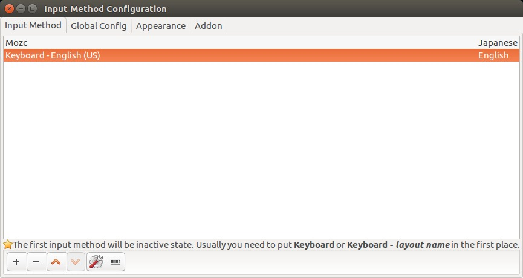

<h1 align="center">
  dotfiles
</h1>

<h4 align="center">
  My dotfiles.
</h4>

<div align="center">
  <a href="https://github.com/wkentaro/dotfiles/actions"></a>
</div>

<br/>

<div align="center">
  
</div>


## Usage

```bash
INSTALL_DIR=~/ghq/github.com/wkentaro/dotfiles  # you can change this location
git clone --recursive https://github.com/wkentaro/dotfiles.git $INSTALL_DIR && cd $INSTALL_DIR
make install
```

### Windows

`make install` is Unix-only. On Windows, install the dependencies and link
the cross-platform files by hand (symlinks need Developer Mode or admin):

```powershell
winget install dandavison.delta GitHub.cli jqlang.jq
gh auth login

$repo = "$HOME\ghq\github.com\wkentaro\dotfiles"
New-Item -ItemType Directory -Force "$HOME\.claude\hooks", "$HOME\.claude\rules" | Out-Null
@{
  'gitconfig' = '.gitconfig'
  'claude\settings.json' = '.claude\settings.json'
  'claude\keybindings.json' = '.claude\keybindings.json'
  'claude\statusline-command.sh' = '.claude\statusline-command.sh'
  'claude\hooks\herdr-tab-name.sh' = '.claude\hooks\herdr-tab-name.sh'
  'claude\rules\pstack-models.md' = '.claude\rules\pstack-models.md'
}.GetEnumerator() | ForEach-Object {
  New-Item -ItemType SymbolicLink -Path "$HOME\$($_.Value)" -Target "$repo\$($_.Key)"
}
```

## CLIProxyAPI quota

`cliproxy-quota` shows remaining Claude and Codex quota for every account in
`~/.cli-proxy-api`. It requires Python 3.9 or newer and is installed by
`make install` with the other commands in `local/bin`.

```bash
cliproxy-quota
watch -n 60 cliproxy-quota
cliproxy-quota --auth-dir /path/to/credentials --timeout 15
cliproxy-quota --json | jq '.[] | {email, windows}'
cliproxy-quota --no-fable
```

Each account gets remaining-percentage bars and local reset times. Claude
shows five-hour, weekly, and any reported model-specific weekly limits.
`--no-fable` hides the Fable weekly limit.
Codex labels its primary and secondary windows by their actual duration.
`--json` prints the same accounts as a list of objects, with percentages
used and ISO 8601 UTC times.
Missing limits stay unreported, not 100% available. Code-review allowances,
paid credits, and extra usage are not included.

The command only reads credentials and queries provider usage endpoints. It
never refreshes tokens or changes credential files. Disabled accounts are
listed without querying them. Errors affect only that account; the command
exits with status 1 if any account fails or no accounts are found.

Each account's quota is cached in `~/.cache/cliproxy-quota`, readable only
by you, and reused for 5 minutes while its access token stays the same,
marked `as of HH:MM`, so `watch` does not hit provider rate limits.
After a failed request, the account is not
queried again for a minute, or after an HTTP 429 for the provider's
`Retry-After` seconds, between 1 and 60 minutes (5 minutes when it is
missing, a date, or over 9 digits). Changing the credential file, such as
by re-login, ends any wait but a 429.
When a request fails or is waiting, the last cached quota for the same
access token stays on screen next to the error.

When `~/.cli-proxy-api` is missing or holds no accounts, the command reads
`/quota` from the gateway URL instead, taken from `$ANTHROPIC_BASE_URL` or
`~/.claude/settings-gateway.json`, and numbers the accounts in place of
their emails. An explicit `--auth-dir` never falls back to the gateway.

Output includes account emails and organization names. Keep it private.
Do not commit credential files or live output. If authentication expires,
re-login through CLIProxyAPI and run the command again.

On the proxy host, `cliproxy-quota serve` answers every GET on
`127.0.0.1:8318` with the `--json` output in priority order, minus file
names, emails, and organizations. Run it as a service and publish it next
to the gateway on the tailnet, so any machine there reads `/quota` under the
gateway URL:

```bash
loginctl enable-linger
systemctl --user enable --now cliproxy-quota
tailscale serve --bg --https=8317 --set-path /quota http://127.0.0.1:8318
```

Weekly quota left unused at reset is lost, so `cliproxy-quota prioritize`
ranks watched Claude accounts with weekly quota left by earliest reset.
The account whose quota resets first gets CLIProxyAPI's highest `priority`.
New sessions go to the top account until it hits a limit, then
fall to the next. Running sessions stay on their account. Accounts with
no weekly quota left, or with unknown weekly usage or reset, get
priority 0. It changes priorities through CLIProxyAPI's management API
on `127.0.0.1:8317` with the key in
`~/.config/cliproxyapi/management-key`, and writes an account's priority
only when its value changes.
`cliproxy-quota` then lists each provider's accounts in that order, marked
`priority 1`, `priority 2`, and so on. Run it every 5 minutes:

```bash
systemctl --user enable --now cliproxy-quota-prioritize.timer
```

List the emails of your own Claude accounts, one per line, in
`~/.config/cliproxyapi/own-accounts`. Case, blank lines, and spaces
around an email do not matter, in the file or in a credential. Every
other Claude account is a teammate's, including one with no email,
whatever its file name. `prioritize` keeps teammates' watched
credentials out of routing at priority 0 unless a reading no more than 5
minutes old when `prioritize` fetched it shows more weekly quota left
than time left in its week and at least 50% of its 5-hour quota left. A
cached reading kept after a failed refresh does not count. Both checks
use unrounded values, not the one-decimal percentages `cliproxy-quota`
shows, so an account whose weekly quota left equals its time left stays
out. A 5-hour window reported as `null`, or with neither usage nor a
reset time, is idle and counts as unused. A response with no 5-hour
window, or with a reset time but no usage, keeps the account out. Each
teammate keeps the share of their weekly quota that matches the time
left in their week. Your own accounts always stay in, and without the
file every account counts as yours.

A reading can be up to 5 minutes old and the timer runs every 5
minutes, so sessions can use a teammate's account for an estimated 10
minutes after it reaches either limit. The estimate assumes the timer
fires on schedule and every write succeeds.

`prioritize` keeps an account out by adding `"*"` and the marker
`"cliproxy-quota-reserve"` to the end of its `excluded_models` through
the management API. It lets the account back in by removing the last
`"*"` that comes right before the marker, and writes `null` when nothing
is left. Only that pair, in that order, lets an account back in, and
`prioritize` removes nothing else. Entries you set by hand stay, so
`["claude-opus-*"]` becomes
`["claude-opus-*", "*", "cliproxy-quota-reserve"]` and then
`["claude-opus-*"]` again. A comma-separated string comes back as a
list of the same entries. Entries that are not strings are dropped,
because CLIProxyAPI ignores them and its management API rejects them.
`prioritize` adds nothing to an account that has an entry made only of
`*`, with or without spaces around it, which CLIProxyAPI reads as every
model. To keep an account out by hand, disable it or add `"*"` to its
`excluded_models`. `prioritize` never changes `disabled`, and leaves
`excluded_models` alone on a disabled account. On CLIProxyAPI 8.0.67,
`"*"` keeps an account out of new sessions and of sessions already
bound to it, and still does after CLIProxyAPI restarts.

A watched credential is a regular file at the top level of the auth
directory whose name ends in `.json`, the only kind CLIProxyAPI 8.0.67
reloads when it changes on disk, with no space at either end of its
name, since the management API trims the name it writes to. Every
management write saves the proxy's whole copy of a credential, so
`prioritize` reads a watched credential again right before writing to it
and sends its priority and its `excluded_models` in one request. An
exclusion you edit on disk while it fetches usage therefore stays, even
when the proxy has not reloaded the file yet. It skips the account when
the credential now holds a different email, and reports it and exits
with status 1 when the file can no longer be read or is no longer
watched. When a teammate's access token changed since its reading, the
reading no longer describes that credential, so it stays out until the
next run measures it.

Edit credentials through CLIProxyAPI's management API, or stop
`cliproxy-quota-prioritize.timer` first. The management API has no
conditional update, so any edit made on disk while `prioritize` runs
can be lost, such as a token written to the file or an exclusion saved
by renaming a file over the credential.

CLIProxyAPI 8.0.67 also routes credentials it does not watch: files in
auth subdirectories, symlinks, and names ending in `.JSON` or another
case. It ignores a nested file's model exclusions after restarting, and
a write to any of them can save a stale copy over your edits. A write to
a name with a space at either end can reach another credential.
`prioritize` reads only the top level of the auth directory and never
writes to those credentials. With `own-accounts` set, it names each such
teammate credential the proxy lists and exits with status 1 after
handling the watched accounts. That credential can still route. Make it
a regular file named `*.json`, with no space at either end, at the top
level of the auth directory, restart CLIProxyAPI, and rerun
`cliproxy-quota prioritize` to apply the reserve. It does the same for a
listed teammate credential whose file it cannot read as a Claude
credential, such as one with invalid JSON, which CLIProxyAPI keeps
routing from its last good copy.

`cliproxy-quota` and `serve` still report quotas for credentials in the
auth directory and its subdirectories, skipping a subdirectory they
cannot read. They match `.json` and `type` in
any case and name credentials by their paths relative to the auth directory.
`cliproxy-quota` on the proxy host marks a watched Claude account with
its exclusion pair `Reserved for its owner`, and `--json` shows it as
`"reserved": true`.
`serve` leaves it out, so `/quota` and `cliproxy-quota` reading the
gateway never show it.

Each account's changes are one request. When one fails, `prioritize`
reports it, goes on with the other accounts, and exits with status 1.


## macOS

### iTerm2

* Download iTerm color schemes from https://github.com/mbadolato/iTerm2-Color-Schemes.
* `Iterm2 > Preferences > Profiles > Colors > Load Presets > __Dark Pastel__`.


## Ubuntu 16.04

### Input Method

* Select `fcitx` for `Keyboard input method system` in `Language Support`.
* Logout + login.
* Open fcitx settings and configure as below:



