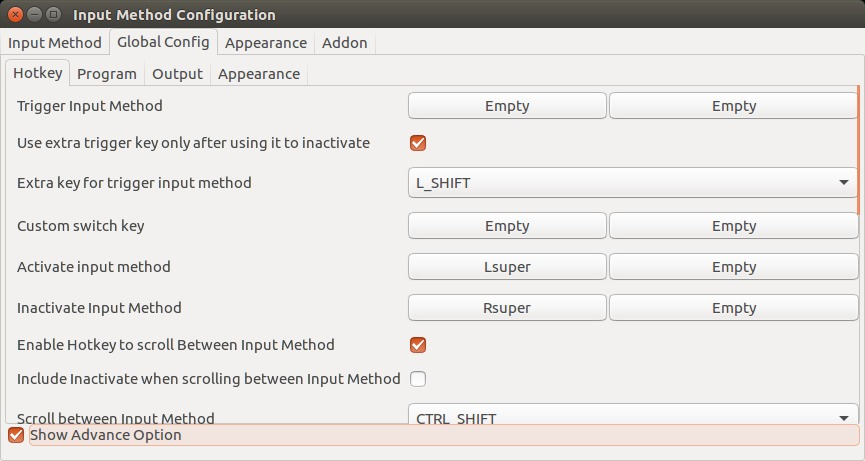

<h1 align="center">
  dotfiles
</h1>

<h4 align="center">
  My dotfiles.
</h4>

<div align="center">
  <a href="https://github.com/wkentaro/dotfiles/actions"></a>
</div>

<br/>

<div align="center">
  
</div>


## Usage

```bash
INSTALL_DIR=~/ghq/github.com/wkentaro/dotfiles  # you can change this location
git clone --recursive https://github.com/wkentaro/dotfiles.git $INSTALL_DIR && cd $INSTALL_DIR
make install
```


## Claude models in Pi

`pi/agent/settings.json` includes the Claude Code extension and scopes model
cycling to Codex and Claude Code Opus. Pi installs the extension at startup.

On each machine, pull dotfiles and run `make install`. Install Claude Code
if needed, then run `claude auth login` with the account you want that machine
to use. Restart Pi and run `/claude-code-status` to verify the login.
Credentials stay on each machine and are not shared through dotfiles.
Existing regular `~/.pi/agent/settings.json` files are skipped by the installer;
back up that file and replace it with a symlink to `pi/agent/settings.json`.

The Claude Code provider is experimental and uses the logged-in account's
subscription quota. This configuration leaves Pi's default provider unchanged;
choose Claude Code Opus with `/model`.

## CLIProxyAPI quota

`cliproxy-quota` shows remaining Claude and Codex quota for every account in
`~/.cli-proxy-api`. It requires Python 3.9 or newer and is installed by
`make install` with the other commands in `local/bin`.

```bash
cliproxy-quota
watch -n 60 cliproxy-quota
cliproxy-quota --auth-dir /path/to/credentials --timeout 15
cliproxy-quota --json | jq '.[] | {email, windows}'
cliproxy-quota --no-fable
```

Each account gets remaining-percentage bars and local reset times. Claude
shows five-hour, weekly, and any reported model-specific weekly limits.
`--no-fable` hides the Fable weekly limit.
Codex labels its primary and secondary windows by their actual duration.
`--json` prints the same accounts as a list of objects, with percentages
used and ISO 8601 UTC times.
Missing limits stay unreported, not 100% available. Code-review allowances,
paid credits, and extra usage are not included.

The command only reads credentials and queries provider usage endpoints. It
never refreshes tokens or changes credential files. Disabled accounts are
listed without querying them. Errors affect only that account; the command
exits with status 1 if any account fails or no accounts are found.

Each account's quota is cached in `~/.cache/cliproxy-quota`, readable only
by you, and reused for 5 minutes, marked `as of HH:MM`, so `watch` does not
hit provider rate limits. After a failed request, the account is not
queried again for a minute, or after an HTTP 429 for the provider's
`Retry-After` seconds, between 1 and 60 minutes (5 minutes when it is
missing, a date, or over 9 digits). Changing the credential file, such as
by re-login, ends any wait but a 429.
When a request fails or is waiting, the last cached quota stays on screen
next to the error.

When `~/.cli-proxy-api` is missing or holds no accounts, the command reads
`/quota` from the gateway URL instead, taken from `$ANTHROPIC_BASE_URL` or
`~/.claude/settings-gateway.json`, and numbers the accounts in place of
their emails. An explicit `--auth-dir` never falls back to the gateway.

Output includes account emails and organization names. Keep it private.
Do not commit credential files or live output. If authentication expires,
re-login through CLIProxyAPI and run the command again.

On the proxy host, `cliproxy-quota serve` answers every GET on
`127.0.0.1:8318` with the `--json` output, minus file names, emails, and
organizations. Run it as a service and publish it next to the gateway on the
tailnet, so any machine there reads `/quota` under the gateway URL:

```bash
loginctl enable-linger
systemctl --user enable --now cliproxy-quota
tailscale serve --bg --https=8317 --set-path /quota http://127.0.0.1:8318
```

Weekly quota left unused at reset is lost, so `cliproxy-quota prioritize`
gives the Claude account whose weekly quota resets first CLIProxyAPI's
highest `priority`, and the account that resets last the lowest. New
sessions go to the top account until it hits a limit, then fall to the
next. Running sessions stay on their account. Accounts without a known
reset get priority 0. It changes priorities through CLIProxyAPI's
management API on `127.0.0.1:8317` with the key in
`~/.config/cliproxyapi/management-key`, and only when the order changes.
`cliproxy-quota` then shows each account's place in line as
`priority 1`, `priority 2`, and so on. Run it every 5 minutes:

```bash
systemctl --user enable --now cliproxy-quota-prioritize.timer
```


## macOS

### iTerm2

* Download iTerm color schemes from https://github.com/mbadolato/iTerm2-Color-Schemes.
* `Iterm2 > Preferences > Profiles > Colors > Load Presets > __Dark Pastel__`.


## Ubuntu 16.04

### Input Method

* Select `fcitx` for `Keyboard input method system` in `Language Support`.
* Logout + login.
* Open fcitx settings and configure as below:



